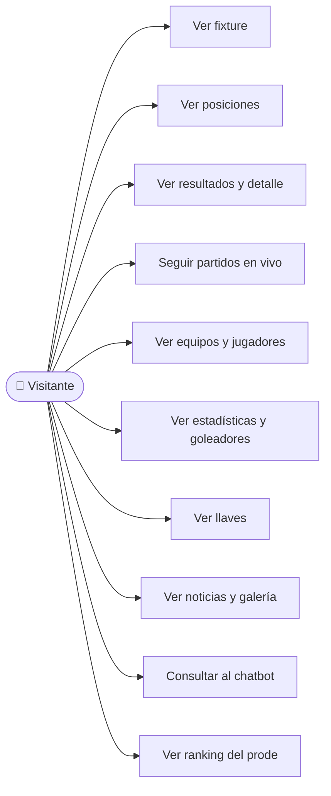
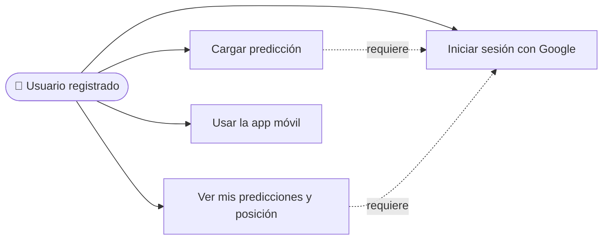
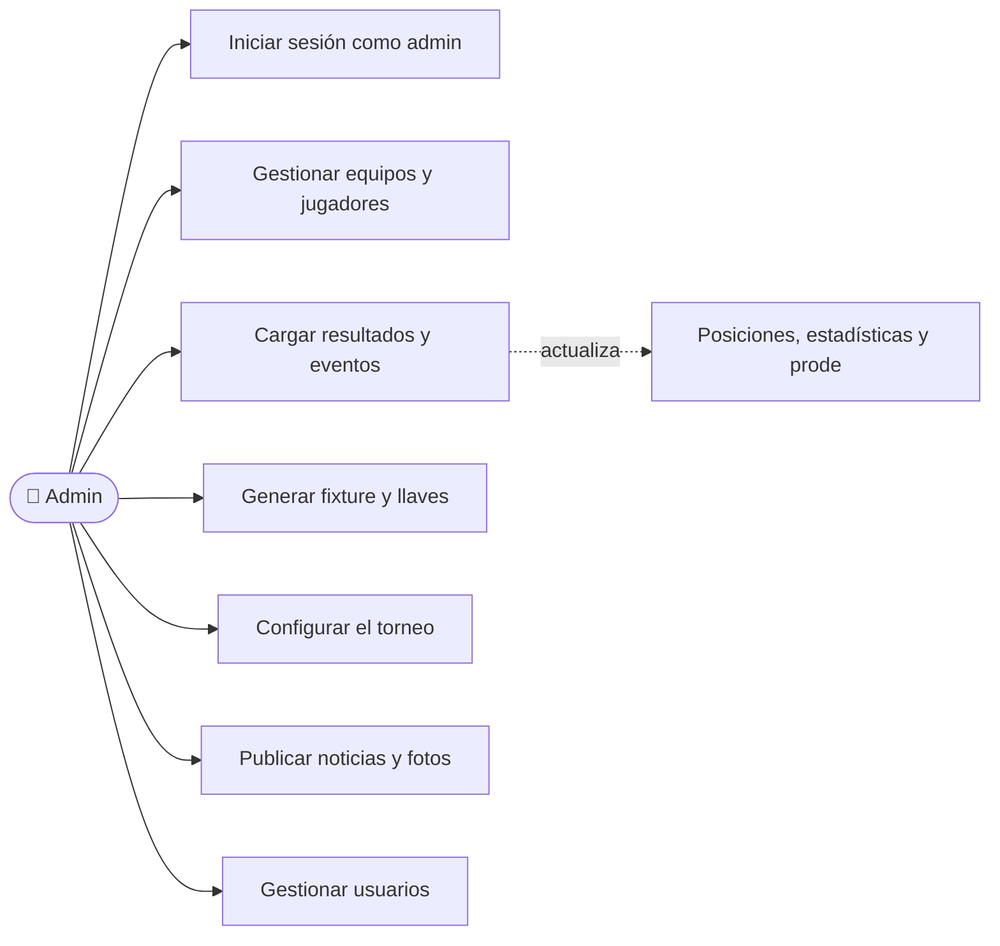

# Análisis funcional — Copa ETec

Actores, casos de uso e historias de usuario del sistema (API, web y app móvil). Cada historia es un issue con la etiqueta [`historia`](https://github.com/pretch-app/copaetec-backend/issues?q=label%3Ahistoria); las tareas técnicas llevan la etiqueta [`tarea`](https://github.com/pretch-app/copaetec-backend/issues?q=label%3Atarea).

## Actores

| Actor | Quién es | Cómo accede |
| --- | --- | --- |
| Visitante | Cualquier persona que entra al sitio | Sin iniciar sesión |
| Usuario registrado | Alumno o docente de la ETec/UM que juega el prode | Login con Google (solo dominios institucionales) |
| Admin | Organizadores del torneo | Login con email y contraseña ("Acceso de Administrador") |

Un usuario registrado puede hacer todo lo que hace un visitante, y un admin todo lo que hace un usuario registrado.

## Casos de uso

### Visitante

### Usuario registrado

### Admin

## Historias de usuario

| # | Actor | Historia | Estado |
| --- | --- | --- | --- |
| [#10](https://github.com/pretch-app/copaetec-backend/issues/10) | Visitante | Ver el fixture del torneo | Hecha |
| [#11](https://github.com/pretch-app/copaetec-backend/issues/11) | Visitante | Ver la tabla de posiciones | Hecha |
| [#12](https://github.com/pretch-app/copaetec-backend/issues/12) | Visitante | Ver los resultados y el detalle de un partido | Hecha |
| [#13](https://github.com/pretch-app/copaetec-backend/issues/13) | Visitante | Seguir los partidos en vivo | Hecha |
| [#14](https://github.com/pretch-app/copaetec-backend/issues/14) | Visitante | Ver los equipos y sus jugadores | Hecha |
| [#15](https://github.com/pretch-app/copaetec-backend/issues/15) | Visitante | Ver estadísticas y goleadores | Hecha |
| [#16](https://github.com/pretch-app/copaetec-backend/issues/16) | Visitante | Ver las llaves de eliminación | Hecha |
| [#17](https://github.com/pretch-app/copaetec-backend/issues/17) | Visitante | Ver noticias y galería de fotos | Hecha |
| [#18](https://github.com/pretch-app/copaetec-backend/issues/18) | Visitante | Consultar al chatbot | Hecha |
| [#19](https://github.com/pretch-app/copaetec-backend/issues/19) | Visitante | Ver el ranking del prode | Hecha |
| [#36](https://github.com/pretch-app/copaetec-backend/issues/36) | Visitante | Consultar por Telegram (opcional) | Pendiente |
| [#20](https://github.com/pretch-app/copaetec-backend/issues/20) | Usuario registrado | Iniciar sesión con Google | Hecha |
| [#21](https://github.com/pretch-app/copaetec-backend/issues/21) | Usuario registrado | Cargar una predicción | Hecha |
| [#22](https://github.com/pretch-app/copaetec-backend/issues/22) | Usuario registrado | Ver mis predicciones y mi posición | Hecha |
| [app#2](https://github.com/pretch-app/copaetec-app/issues/2) | Usuario registrado | Usar la app móvil | Pendiente |
| [#23](https://github.com/pretch-app/copaetec-backend/issues/23) | Admin | Gestionar equipos y jugadores | Hecha |
| [#24](https://github.com/pretch-app/copaetec-backend/issues/24) | Admin | Cargar resultados y eventos de partidos | Hecha |
| [#25](https://github.com/pretch-app/copaetec-backend/issues/25) | Admin | Generar el fixture y las llaves | Hecha |
| [#26](https://github.com/pretch-app/copaetec-backend/issues/26) | Admin | Configurar el torneo | Hecha |
| [#27](https://github.com/pretch-app/copaetec-backend/issues/27) | Admin | Publicar noticias y fotos | Hecha |
| [#28](https://github.com/pretch-app/copaetec-backend/issues/28) | Admin | Gestionar usuarios | Hecha |

## Cómo se trabaja

1. Todo trabajo nuevo (historia, tarea o bug) arranca como un issue.
2. Se crea una rama desde `main` (cada rama despliega un preview en Vercel).
3. Se abre un PR que cierra el issue con `Closes #N`. `main` exige PR y que pasen los tests.
4. Al mergear a `main`, Vercel despliega a producción.
